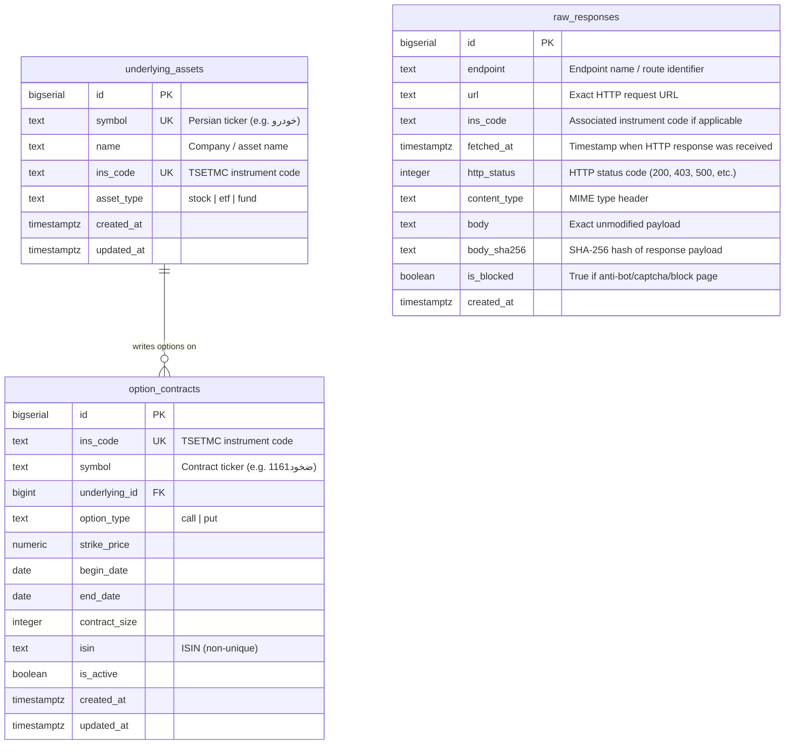

# PostgreSQL Database Schema

This document details the database architecture for the TSETMC options tick-data platform, including table definitions, relationships, constraints, and key architectural rationales.

---

## 1. Schema Overview

The database uses PostgreSQL with schema migrations managed by `golang-migrate` embedded directly in the Go backend binary.

---

## 2. Table Specifications

### 2.1 `underlying_assets`
Represents the spot underlying securities (equities, exchange-traded funds, mutual funds) traded on the Tehran Stock Exchange upon which derivatives contracts are structured.

| Column | Type | Constraints | Description |
| :--- | :--- | :--- | :--- |
| `id` | `BIGSERIAL` | `PRIMARY KEY` | Internal surrogate primary key. |
| `symbol` | `TEXT` | `NOT NULL UNIQUE` | Official Persian symbol (e.g., `خودرو`, `اهرم`, `اطلس`). |
| `name` | `TEXT` | `NULLABLE` | Full formal corporate or fund title. |
| `ins_code` | `TEXT` | `UNIQUE NULLABLE` | TSETMC numeric instrument code (populated by asset registry crawler). |
| `asset_type` | `TEXT` | `NOT NULL CHECK (asset_type IN ('stock', 'etf', 'fund'))` | Asset classification type. |
| `created_at` | `TIMESTAMPTZ` | `NOT NULL DEFAULT now()` | Record insertion timestamp. |
| `updated_at` | `TIMESTAMPTZ` | `NOT NULL DEFAULT now()` | Record modification timestamp. |

#### Baseline Seed Data
Migration `000003_seed_underlying_assets` inserts 25 baseline underlying assets with initial `ins_code` set to `NULL`:
- **ETF (`etf`)**: `اطلس`, `توان`
- **Fund (`fund`)**: `موج`, `اهرم`, `فزر`
- **Stock (`stock`)**: `شپنا`, `تاصیکو`, `جوانه`, `کاریزما`, `ذوب`, `خودرو`, `خبهمن`, `طعام`, `خساپا`, `فملی`, `وتجارت`, `دزاگرس`, `شستا`, `وبصادر`, `اخابر`, `همتراز`, `وبملت`, `بساما`, `دارونو`, `فرابورس`

---

### 2.2 `option_contracts`
Stores the metadata and parameters of option contracts listed on the exchange.

| Column | Type | Constraints | Description |
| :--- | :--- | :--- | :--- |
| `id` | `BIGSERIAL` | `PRIMARY KEY` | Internal surrogate primary key. |
| `ins_code` | `TEXT` | `NOT NULL UNIQUE` | Canonical TSETMC instrument code. |
| `symbol` | `TEXT` | `NOT NULL` | Contract ticker symbol (e.g., `ضخود1161`). |
| `underlying_id`| `BIGINT` | `NOT NULL REFERENCES underlying_assets(id) ON DELETE RESTRICT` | Foreign key referencing the parent underlying asset. |
| `option_type` | `TEXT` | `NOT NULL CHECK (option_type IN ('call', 'put'))` | Contract derivative type. |
| `strike_price`| `NUMERIC` | `NOT NULL` | Contract execution strike price in IRR. |
| `begin_date` | `DATE` | `NULLABLE` | Trading commencement date. |
| `end_date` | `DATE` | `NOT NULL` | Contract expiration / maturity date. |
| `contract_size`| `INTEGER` | `NOT NULL DEFAULT 1000` | Multiplier / number of underlying shares per contract. |
| `isin` | `TEXT` | `NULLABLE` | 12-character security ISIN identifier (non-unique). |
| `is_active` | `BOOLEAN` | `NOT NULL DEFAULT true` | Contract operational trading status. |
| `created_at` | `TIMESTAMPTZ` | `NOT NULL DEFAULT now()` | Record insertion timestamp. |
| `updated_at` | `TIMESTAMPTZ` | `NOT NULL DEFAULT now()` | Record modification timestamp. |

#### Indexes
- `idx_option_contracts_underlying_id` on `(underlying_id)`: Accelerates queries joining contracts to underlying assets or grouping options by root security.
- `idx_option_contracts_end_date` on `(end_date)`: Accelerates maturity filters (e.g., active series selection, expiration processing).

---

### 2.3 `raw_responses`
The immutable staging layer for all network payloads retrieved by data collectors.

| Column | Type | Constraints | Description |
| :--- | :--- | :--- | :--- |
| `id` | `BIGSERIAL` | `PRIMARY KEY` | Internal surrogate primary key. |
| `endpoint` | `TEXT` | `NOT NULL` | Semantic API name (e.g., `InstrumentInfo`, `ClosingPrices`, `TradeTicks`). |
| `url` | `TEXT` | `NOT NULL` | Complete HTTP request URI executed by crawler. |
| `ins_code` | `TEXT` | `NULLABLE` | Target instrument identifier if request was instrument-specific. |
| `fetched_at` | `TIMESTAMPTZ` | `NOT NULL` | Exact network retrieval timestamp. |
| `http_status` | `INTEGER` | `NOT NULL` | HTTP response code (200, 403, 500, etc.). |
| `content_type` | `TEXT` | `NULLABLE` | Response `Content-Type` header (e.g., `application/json`, `text/html`). |
| `body` | `TEXT` | `NOT NULL` | Raw verbatim payload body (including empty or error HTML). |
| `body_sha256` | `TEXT` | `NOT NULL` | Hex-encoded SHA-256 digest of payload for deduplication. |
| `is_blocked` | `BOOLEAN` | `NOT NULL DEFAULT false` | Flag indicating whether response represents a bot ban, captcha, or CDN block. |
| `created_at` | `TIMESTAMPTZ` | `NOT NULL DEFAULT now()` | Database insertion timestamp. |

#### Constraints & Indexes
- `uq_raw_responses_url_body_sha256`: Unique constraint on `(url, body_sha256)` ensuring idempotent writes.
- `idx_raw_responses_endpoint_ins_code_fetched_at`: Composite index on `(endpoint, ins_code, fetched_at)` facilitating time-series raw audit lookups and replay parser extraction.

---

## 3. Key Architectural Decisions

### 3.1 Why `ins_code` is the Real Canonical Key (Not Symbol or ISIN)

1. **Symbol Instability & Encoding Ambiguity**:
   - Symbols in Iranian financial systems contain Arabic vs. Persian character variants (such as `ی` vs. `ي`, and `ک` vs. `ك`) and optional zero-width non-joiners (ZWNJ).
   - Exchange tickers can change upon capital reorganizations, corporate name changes, or regulatory re-listing.
2. **ISIN Unreliability in TSETMC**:
   - In Iranian exchange databases, ISINs for derivative contracts are frequently duplicated across consecutive cycles or assigned dummy placeholder values (such as `IRO...` duplicates). Relying on ISIN as a unique key produces foreign key or duplicate key violations.
3. **`ins_code` as the Ground Truth**:
   - `ins_code` is a 64-bit numeric string (e.g., `44891414436813209`) issued directly by the exchange matching engine.
   - Every internal TSETMC endpoint (`tsetmc.com/Loader.aspx?ParTree=151311&i=...`, `cdn.tsetmc.com/api/Instrument/...`) strictly indexes market data by `ins_code`. It is immutable throughout the instrument's entire lifecycle.

### 3.2 Why Raw Responses are Stored Verbatim Before Cleaning (ELT Pattern)

1. **Zero Data Loss & Auditability**:
   - Financial data crawlers operating against non-documented legacy exchange endpoints face intermittent HTML error responses, rate-limiting redirects, or transient payload truncations. Storing verbatim raw data ensures no information is lost during network ingestion.
2. **Retroactive Parsing & Parser Improvements**:
   - When cleaner/parser logic improves or when historical adjustments are discovered, the platform can replay parsing over immutable raw records without making new requests to TSETMC.
3. **Strict Idempotency via Hashing**:
   - The unique constraint `(url, body_sha256)` allows workers to fetch and submit snapshots without fear of storing duplicate redundant payloads.
4. **Automated Anti-Bot and Block Auditing**:
   - By capturing HTTP status codes and payloads of rejected requests (`is_blocked = true`), the platform monitors IP reputation and rate-limiting thresholds over time.
